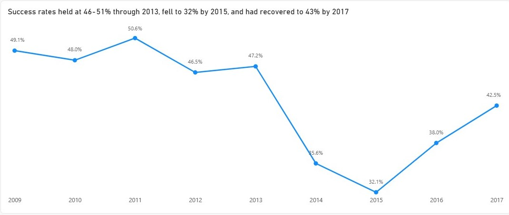
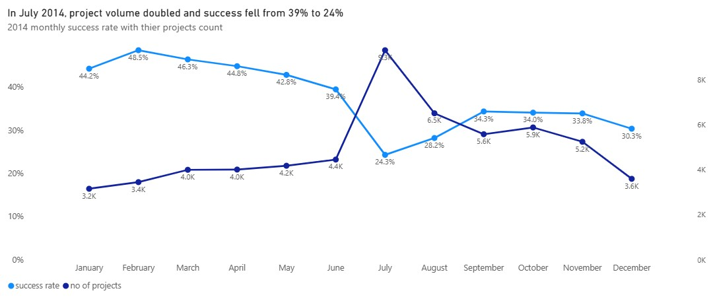
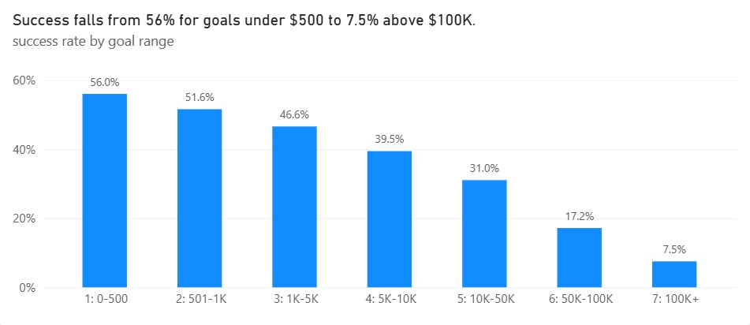
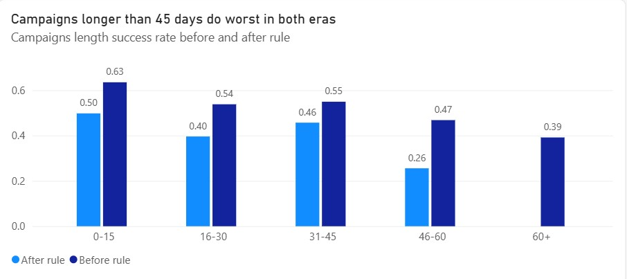
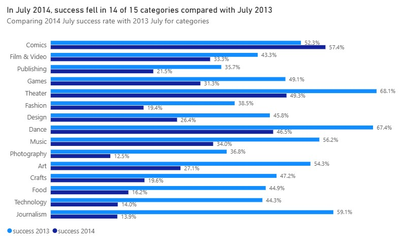

# Kickstarter Projects Analysis (2009-2017)

A SQL analysis of 374,853 Kickstarter projects : which projects succeed, how success rates changed over time, how campaign length affects success rate and what happened during the 2014 decline.

**Tools**: Microsoft SQL Server (SSMS), T-SQL, Power BI.

## Key Findings:
- **Overall success rate is 40.4%** (133,851 of 331,462 projects with a known outcome).
- **Dance has the highest category success rate (65.4%)**, but it holds only about 1% of projects. The largest categories are Film & Video (17% of projects, 41.8% success) and Music (13.8% of projects, 52.6% success).
- **Goal size has the widest spread:** success falls steadily from 56.0% for goals up to $500 to 7.5% for goals above $100K.
- **Campaigns longer than 45 days do worst in both eras** having the lowest success rate in both eras.
- **Success rates fell sharply in 2014:** from about 47% in 2013 to 36% in 2014 and 32% in 2015, then partly recovered.
- **The July 2014 drop was broad:** success fell in 14 of 15 categories, and the share of projects that received no pledges at all jumped from 8.2% to 23.1% in a single month.
- **Among the largest segments, US Music projects with 31–45 day campaigns and $1K–$5K goals did best (63.1%).**

  
*2009 starts in April, and late-2017 projects are not all resolved yet.*

  
*In July 2014 the number of projects doubled and the success rate fell from 39% to 24%.*

---

## About the Dataset
- **Source**: Data is obtained from Maven Analytics.
- **Size**: It consists of 374,853 rows.
- **Time period**: 21 April 2009 to 2 january 2018.
- **Raw table** : kickstarter_projects.

| Column name | Type | Description |  
|---|---|---|
|ID | int | Unique number assigned to each project |
|Name | nvarchar | Project's name |
|Category | nvarchar | Project's category |
|Subcategory | nvarchar | Project's Subcategory |
|Country | nvarchar | Project's origin country | 
|Launched | datetime2 | Project's launch date| 
|Deadline | datetime2 | Project's funding deadline |
|Goal | int | Project's funding goal |
|Pledged | int | Amount pledged  |
|Backers | int | Number of people funding project|
|State | nvarchar | Project's state : Live, Successful, Failed, Suspended, and Canceled  |

- To enrich the data derived columns as campaign_days(int), campaign_range(varchar) and goal_range(varchar) were added. 
- Launched and Deadline were cast to date from datetime2.
- Goal and Pledged from int to bigint.


## Workflow
The sequence goes in order:

1. **Data Audit** ([01_data_audit.sql](sql/01_data_audit.sql)): Finding inconsistencies (NULL values, duplicates, extra spaces etc) in the dataset and suggesting appropriate action.
2. **Creating views** ([02_creating_views.sql](sql/02_creating_views.sql)): Creating views for cleaned data and enriching it with derived columns.  
 
    Data preparation and Decisions table to explain what and why changes were made 

3. **Business questions** ([03_stakeholder_questions.sql](sql/03_stakeholder_questions.sql)): Answering the four questions suggested by the dataset’s source.
4. **Extra exploration** ([04_extra_exploration.sql](sql/04_extra_exploration.sql)): Curiosity and ad-hoc questions analysis.

## Data audit
Checked : Nulls, Duplicates, Extra spaces, Distinct country, category, subcategory and state values, Earliest and last date for dataset, Inconsistency in data logic (such as successful_yet_failed projects)
- Extra spaces found in name and country column.
- launched and deadline columns are datetime2, where date will suffice here.
- Data ranges from April 2009 to 2 January 2018; 2009 and 2018 are partial years and late 2017 is immature.
- 15 rows exist with inconsistent  data logic (pledged without backers, successful yet failed, failed yet successful).
- There are 51,810 projects with zero pledge.
- 130 projects have campaign days more than 60 days after 2011 rule change. 

## Creating views
From kickstarter_projects two views were created: clean_kickstarter_projects and  clean_kickstarter_projects_resolved.  
- clean_kickstarter_projects: Created using kickstarter_projects by cleaning it and enriching with derived columns. 
- clean_kickstarter_projects_resolved: Created using clean_kickstarter_projects with a filter to have only resolved projects (successful and failed projects).

**Table of derived columns** : 

|Name|Type|Description|
|---|---|---|
|campaign_days|int|No of days from launched to deadline date |
|campaign_range|varchar| 15 days interval, dividing campaign days into ranges 0-15, 16-30, 31-45, 46-60 and 60+. |
|goal_range|varchar| goals are divided in ranges 0-500, 501-1K, 1K-5K, 5K-10K, 10K-50K, 50K-100K, 100K+|


## Data Preparation and Decisions

### Data Quality Checks

*Objective: Identify structural issues that could affect the reliability of the dataset.*

| Check | Finding | Action |
|---|---|---|
| NULL values | None found | No action required |
| Duplicate records | None found | No action required |
| Extra whitespace | Found in `Name` and `Country` | Removed leading and trailing spaces using `TRIM()` |
| Date sequence | No records where `Deadline < Launched` | No action required |

### Data Abnormalities and Exceptions

*Objective: Identify unusual records and understand how they should be handled during analysis.*

| Observation | Finding | Analytical Decision |
|---|---|---|
| Zero-pledged projects | 51,810 (13.8% of all projects) | Retained; treated as failures where the project state is `Failed` |
| Zero funding goals | 4 projects | Retained; excluded from goal-completion analysis using `Goal > 1000` |
| Inconsistent records | 15 records across three checks (e.g. failed projects with pledges at or above their goals) | Retained; `State` treated as the source of truth |
| Campaigns exceeding 60 days | 4,824 resolved projects; 4,694 launched before the 2011 rule change and 130 after | Retained and analysed separately by era |

### Data Types and Technical Preparation

*Objective: Prepare columns for accurate and meaningful calculations.*

| Column / Issue | Finding | Action |
|---|---|---|
| `Launched` and `Deadline` | Stored as `DATETIME2` | Converted to `DATE` for date-level analysis |
| `Goal` and `Pledged` | Stored as `INT`; calculations can exceed the `INT` limit | Cast to `BIGINT` before performing calculations |

### Dataset Limitations and Analytical Assumptions

*Objective: Document limitations that may influence the interpretation of results.*

| Limitation | Finding | Analytical Decision |
|---|---|---|
| Partial periods | 2009 starts on 21 April; 2018 contains only two days and no resolved projects | 2009 treated as a partial year; 2018 excluded from annual success-rate comparisons |
| Immature data | November–December 2017 contain mostly unresolved projects | Late 2017 flagged as immature |
| Unresolved projects | Canceled: 38,751; Live: 2,798; Suspended: 1,842 | Success rates calculated using only Successful and Failed projects (331,462). All records retained in the base view |
| Currency | Currency documentation unavailable | Values assumed to be USD; median goals by country fall between $3K and $15K, which is inconsistent with unconverted local currencies.|

---
## Business questions
Here business questions suggested by data's source are answered. This is brief questions wise summary for detailed findings and queries see ([03_stakeholder_questions.sql](sql/03_stakeholder_questions.sql)).

Success rate = Successful/(successful + failed)

1. **Which category has the highest success percentage? How many projects have been successful?**  
**Answer** : Dance, 65.44% (2,338 of 3,573). Overall, 133,851 of 331,462 resolved projects succeeded (40.38%)


2. **What project with a goal over $1,000 USD, had the biggest Goal Completion % (Pledged / Goal)? How much money was pledged?**  
**Answer** : "Exploding Kittens" (Games) had the highest goal completion: $8,782,572 pledged on a $10,000 goal (87,825.72%)


3. **Can you identify any trends in project success rates over the years?**  
**Answer** : 

|year 	|	no_of_projects	|	Success_rate(%)	|
|-------|-------------------|-------------------|
|2009	|		1179		|		49.11		|
|2010	|		9577		|		47.96		|
|2011	|		24048		|		50.61		|
|2012	|		38478		|		46.5		|
|2013	|		41088		|		47.22		|
|2014	|		59305		|		35.59		|
|2015	|		65272		|		32.13		|
|2016	|		49096		|		38.04		|
|2017	|		43419		|		42.52	    |	

Yearly rate was in 46 - 51% range for 2009-2013 then we observe a sharp dip in 2014 at 36% and 2014 to 2016 stayed between 32% and 38%, then partly recovered to 43% in 2017.


4. **As an investor/backer, what types of projects should you look at?**

**Answer**: Success on Kickstarter means reaching the funding goal, not earning a return, so the data can
only show which projects had better odds of being funded. It cannot guarantee any outcome. The projects
with the best odds had goals under about $5,000, short (0-15 days) or mid-length (31-45 days) campaigns,
and categories like Music.

| Factor | What the data shows | Share of projects |
|---|---|---|
| Goal size | 56.0% success up to $500, 46.6% at $1K–5K, 31.1% at $10K–50K, 7.5% above $100K | 8% / 34% / 25% / 3% |
| Campaign length |0-15 days 50.3% (63.5% before the 2011 rule, 49.8% after); 16-30 days 40.1%; 31-45 days 46.4%; 46+ days did worst within each era|5% / 58% / 22% / 14%|
| Category | Dance 65.4%, Theater 63.8%, Comics 59.1% lead; Music 52.6%; Film & Video 41.8% | 1% / 3% / 3% / 14% / 17% |
| Country | US 41.8%, UK 41.0%: little difference | US 79%, UK 9% |
| Best segment compared | US Music, 31–45 days, $1K–5K goal: 63.1% (2,752 of 4,364) | n/a |

  
*Success falls from 56% for goals up to $500 to 7.5% above $100K. This is an association, not a controlled result.*

Goal size has the widest spread: success fell from 56% for goals up to $500 to 7.5% above $100K. The shortest campaigns (0-15 days) did best but are rare (5% of projects). Campaigns of 16-30 and 31-45 days make up about 81% of projects, and 31-45 days did better (46.4% vs 40.1%). Country mattered little. Music pairs a high success rate (52.6%) with a large share of projects (13.8%), while Dance, Theater and Comics have higher rates but hold only 1-3% of projects each.

These are associations in past projects. Creators choose their own goals and campaign lengths, and the 2014 decline shows that patterns can change. For details and queries see ([03_stakeholder_questions.sql](sql/03_stakeholder_questions.sql))

Note : US has 78% in total projects and and 79% in resolved projects.

## Extra exploration
All queries for this section are in [04_extra_exploration.sql](sql/04_extra_exploration.sql).

### A. Campaign Duration & Success  
**Question** : How does campaign length affect success rate.  

Across all projects, campaign of 60+ days succeeded more often (38.7%) than 46-60 days (27.4%), which seems reversed. Kickstarter initially allowed for campaign to run up to 90 days. It was changed to 60 days on 17 June 2011 [[link](https://www.kickstarter.com/blog/shortening-the-maximum-project-length)]. There are 4824 projects with 60+ campaign days, 4694 projects are before rule, comparing campaign range across complete time period fails to consider this. I divided data into two eras, before and after rule to compare success rate.  

|Campaign length|	Before rule(%)	|	After rule(%)   |
|---|---|---|
|	0-15		 |		63.48		|		49.77       |      
|	16-30		 |		53.78		|		39.58       |
|	31-45		 |		54.92		|		45.68       |
|	46-60		 |		46.79		|		25.55       |
|	60+			 |		39.16		|		23.85 (130 projects)       |

  
*After the rule, only 130 projects ran longer than 60 days, too few to report a rate, so that bar is missing.*

The shortest campaigns did the best in both eras, 46 or more days campaigns perform worst  

### B. Geographic expansion
**Question** : How are the projects distributed across countries, and when did each country start launching projects?
- The US was the only country launching projects until 2012. 
- The UK joined in 2012.
- Canada, Australia, and New Zealand in 2013 
- The rest of Europe and Asia between 2014 and 2017.
- United States make majority of projects 78%, United Kingdom 8.9% and Canada 3.9% together these three make 91% of total projects.

### C. Pledging behaviour : how much money do projects attract?
Beyond success rate looking at money trail. Technology receives highest per backer $129 against comic having $49. Games, Design, and Technology make only about a quarter of resolved projects and have 64% of total money. Failed projects in Journalism, Art and Film & Video raised roughly 1% of asked money, and across all projects the pledged-to-goal-ratio fell from 45% in 2013 to 14% in 2015.


### D. Investigating 2014 decline

**When** : In 2014 yearly success rate drops to 36% from 46-51% range of early years, zooming in monthly success rate of 2014 drops sharply in July, a 15.15 percentage point drop compared to June. See D1.    

**Where** : 14 out of 15 categories success rate fell in July of 2014 as compared to  July of 2013. See D2. 

  
*Some categories have small July counts, so their percentages are unstable.*

**What changed**: 
- No of projects increased to more than two times going June to July (4448 to 9303) in 2014.
- Zero pledged rate increased from 8.2% in June to 23.1% in July.
- Yearly zero pledged rate: 2013 -> 5.85%, 2014 -> 12.93% , 2015 -> 18.77%.
- About 61% of the rise in the failure rate from 2013 to 2014 came from projects with no pledges (7.08 of 11.63 points), and about 39% from failures that did receive pledges.

Not established :  
- What caused the surge in projects
- Why projects failed to attract backers  
---

## Next steps
- Checking whether the July 2014 surge was concentrated in particular countries or goal ranges

## Limitations
- All findings are associations. Creators choose their own goal sizes and campaign lengths, so differences may reflect the kind of project and not the choice itself.
- Goals and pledges are assumed to be in USD.
- Rates pool all years unless stated, and the 2014–2016 period behaves differently from the rest.
- About 79% of projects are from the United States, so conclusions about other countries rest on small samples.
- The root cause of the 2014 decline is not established.

## Repository structure
```
kickstarter-projects-sql-analysis/
├── README.md
├── LICENSE
├── 01_data_audit.sql              data quality checks and decisions
├── 02_views.sql                   cleaned view and resolved-projects view
├── 03_stakeholder_questions.sql   the four business questions
├── 04_extra_exploration.sql       campaign length, geography, pledging behaviour and the 2014 decline
└── charts/
    ├── 01_yearly_success_rate.jpg
    ├── 02_monthly_2014_volume_vs_success.jpg
    ├── 03_success_by_goal_range.jpg
    ├── 04_campaign_length_by_era.jpg
    └── 05_july_2013_vs_2014_by_category.jpg
```

## How to reproduce

1. Download the dataset from Maven Analytics ([link](https://mavenanalytics.io/data-playground/kickstarter-projects)). The data file is not included in this repository.
2. Import it into SQL Server as a table named `kickstarter_projects` (SSMS flat file import).
3. Run the sql files in the numbered order.
[01](sql/01_data_audit.sql) file helps you go through data quality checks, [02](sql/02_views.sql) helps you create analysis ready clean tables, [03](sql/03_stakeholder_questions.sql) and [04](sql/04_extra_exploration.sql) helps you recreate the said analysis.

## Credits

- Dataset: Maven Analytics, Kickstarter Projects.
- Campaign-length rule: Kickstarter blog post, ["Shortening the Maximum Project Length"](https://www.kickstarter.com/blog/shortening-the-maximum-project-length).

## About me 
I'm Dharmveer, a BSc Zoology graduate moving into data analysis. This is my first portfolio project, built with SQL Server and Power BI. I'm interested in turning messy data into clear answers, and I'm looking for entry level data analyst opportunities.  
[LinkedIn](https://www.linkedin.com/in/dharmveer-rathore-395235382/)

